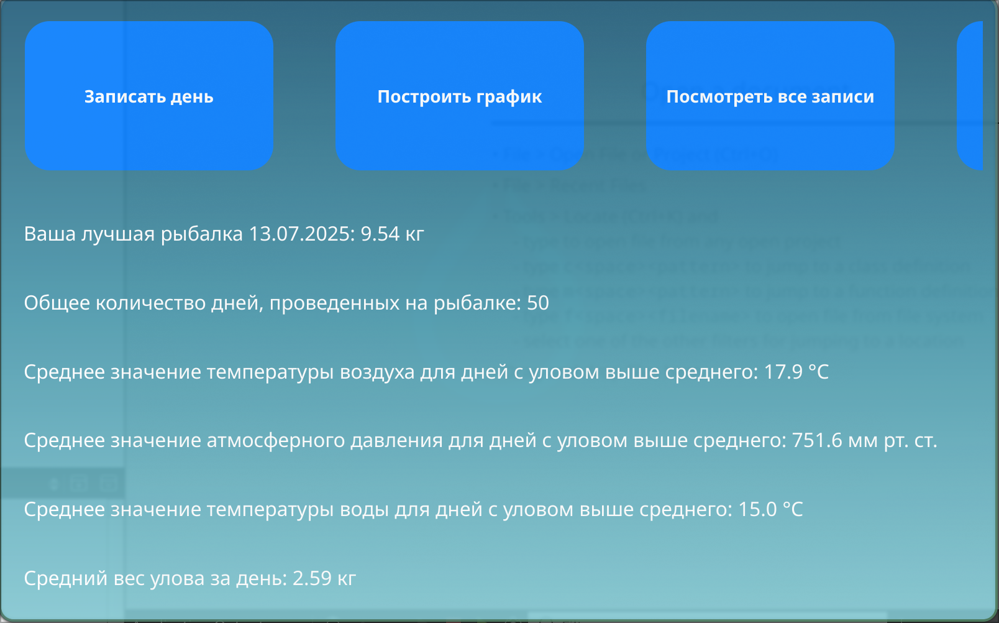
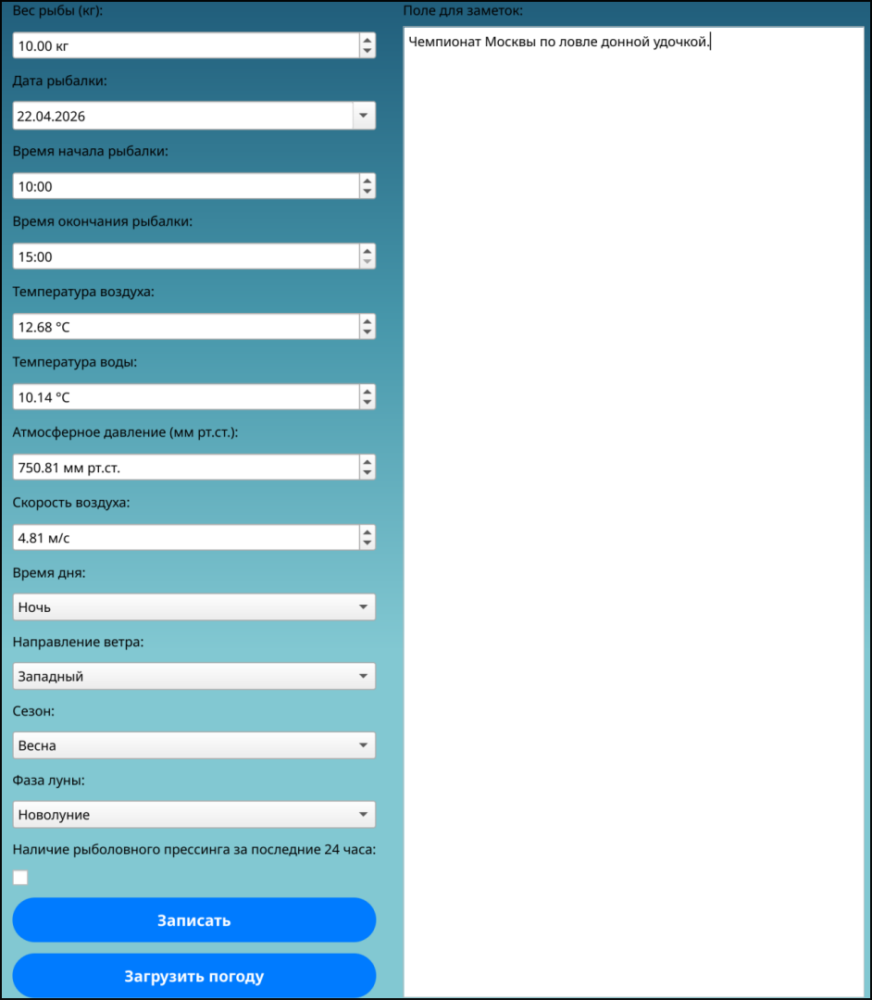
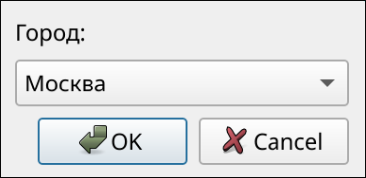
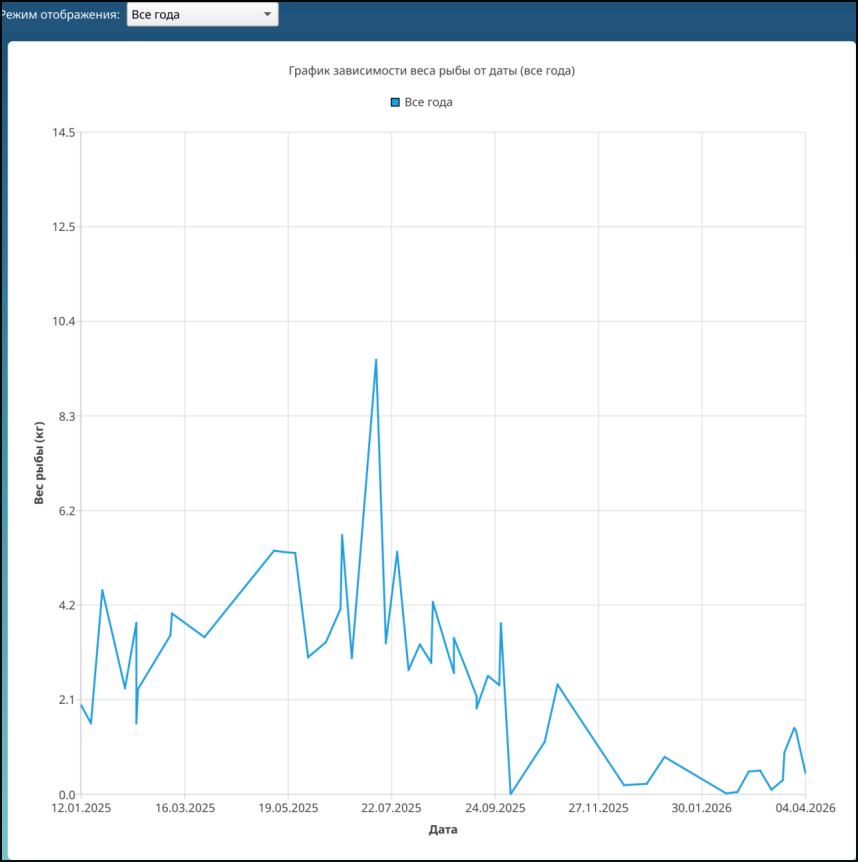
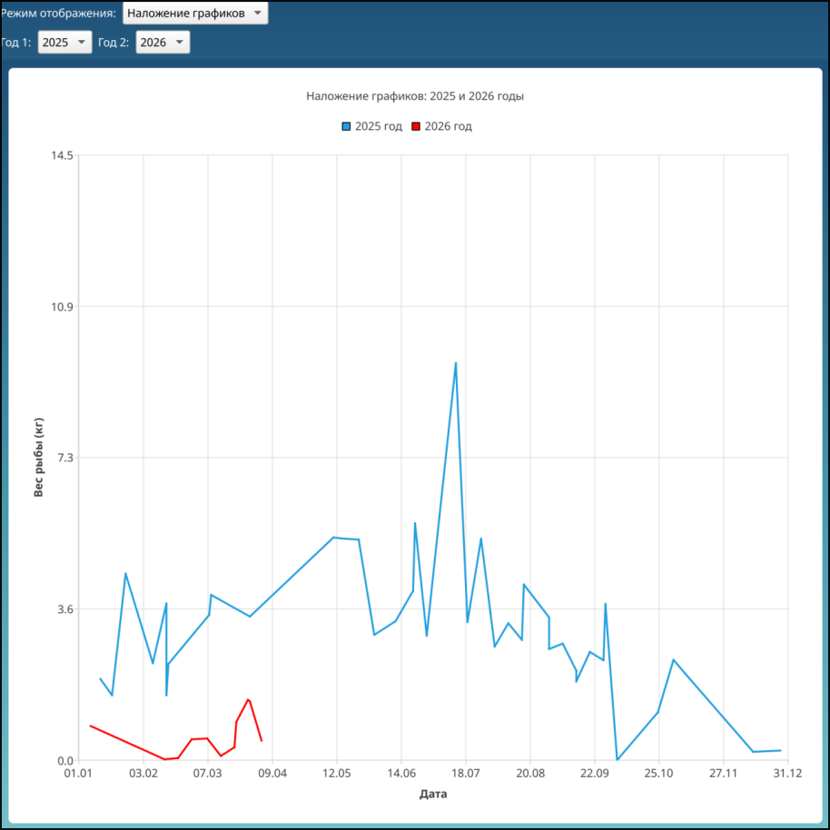
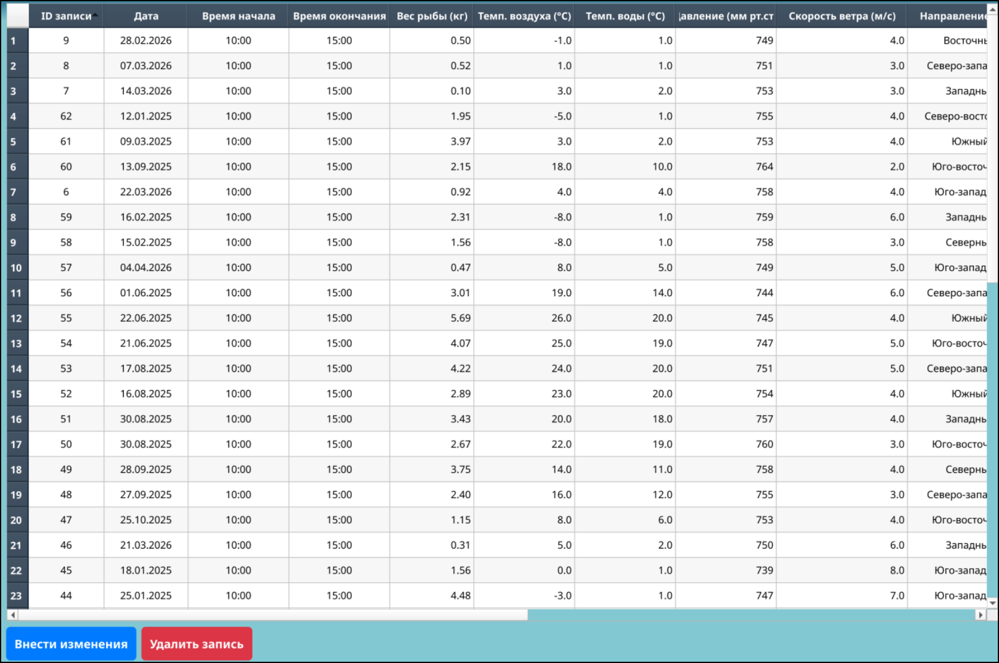
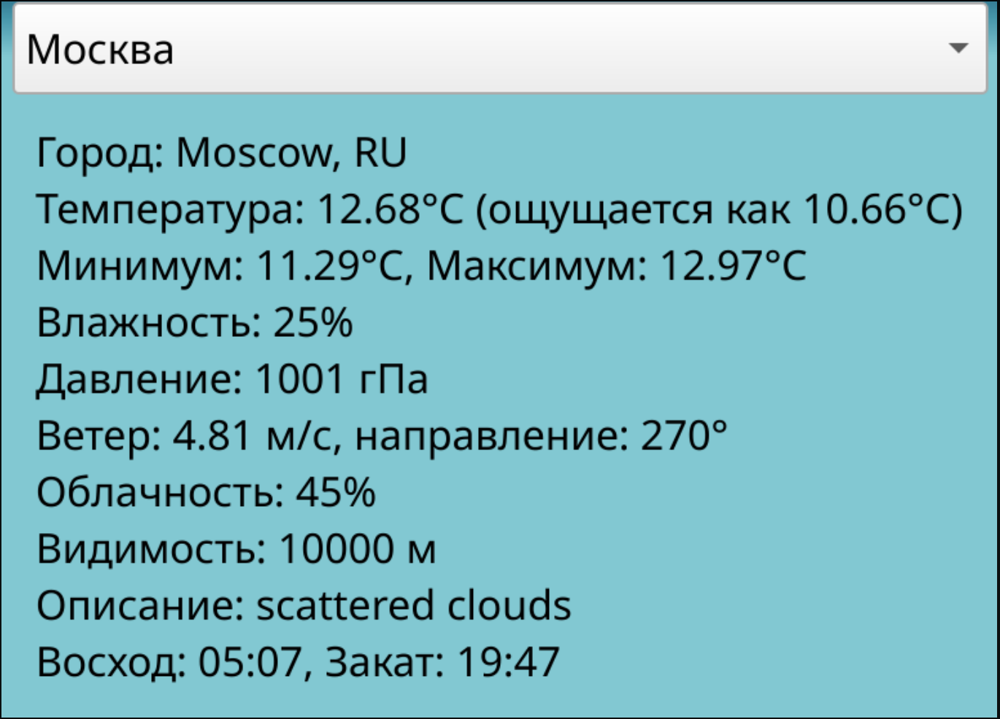
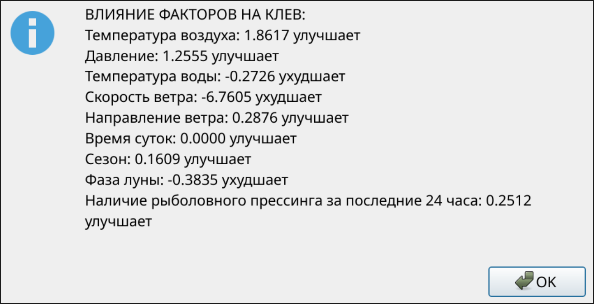
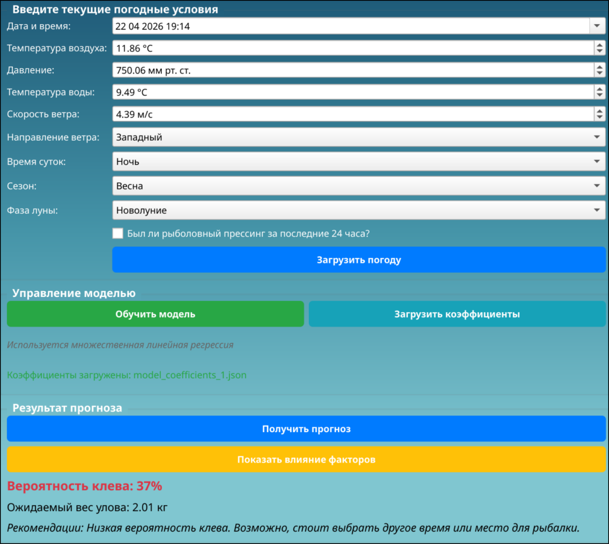

# FishingDiary


Программная система для обработки и визуализации информации о рыболовных уловах. 

---

## Содержание

- [О проекте](#о-проекте)
- [Возможности](#возможности)
- [Скриншоты](#скриншоты)
- [Технологии](#технологии)
- [Архитектура](#архитектура)
- [База данных](#база-данных)
- [Сборка и запуск](#сборка-и-запуск)
- [Использование](#использование)
- [Модель прогнозирования](#модель-прогнозирования)
- [Результаты тестирования](#результаты-тестирования)

---

## О проекте

Рыбалка — одно из самых популярных хобби, но успех ловли зависит от множества факторов: температуры воды и воздуха, атмосферного давления, ветра, времени суток, фазы луны и рыболовного прессинга. Существующие приложения либо дают обобщённый прогноз, либо обучаются на данных пользователей из других стран, что снижает точность для российских водоёмов.

Данная система решает эти проблемы:

- ведёт **личный дневник рыбалок** с полным набором погодных параметров;
- **анализирует** влияние каждого фактора на улов;
- **прогнозирует** результат на основе **собственных накопленных данных** пользователя, что делает прогноз максимально персонализированным.

**Новизна:** в отличие от существующих систем, разработанная система позволяет определить, как **каждый отдельный фактор** влияет на результат рыбалки.

---

## Возможности

- Добавление, редактирование и удаление записей о рыбалке
- Построение графиков зависимости веса улова от даты с наложением за разные годы
- Автоматическая загрузка погодных данных по выбранному городу через API
- Просмотр общей статистики (лучшая рыбалка, средний вес, средние погодные показатели)
- Обучение модели МЛР на исторических данных
- Сохранение и загрузка коэффициентов модели в JSON
- Интерпретация влияния каждого фактора на клёв
- Прогноз вероятности клёва и ожидаемого веса улова
- Учёт 9 предикторов: температура воздуха и воды, давление, скорость и направление ветра, время суток, сезон, фаза луны, рыболовный прессинг

---

## Скриншоты

### Главное окно



Сводка данных: лучшая рыбалка, количество дней, средние значения температуры воздуха, давления и воды, средний вес улова. Кнопки перехода к основным разделам.

### Окно добавления записи о рыбалке



Форма ввода: дата, время начала и окончания, вес улова, погодные параметры, направление ветра, время суток, сезон, фаза луны, комментарий. Кнопка «Загрузить погоду» подтягивает метеоданные по городу.

### Окно выбора города



Выбор города для автоматической загрузки погодных данных.

### Окно анализа данных



График зависимости веса улова от даты. Возможность выбора года и наложения дополнительного графика для сравнения временных отрезков.

### Функция наложения графиков



Сравнение данных из разных временных интервалов на одном графике.

### Окно просмотра всех записей



Таблица со всеми записями. Ячейки редактируемые, есть кнопки сохранения изменений и удаления с подтверждением.

### Окно погодной сводки



Текущие погодные параметры: температура, влажность, давление, ветер, облачность, видимость, восход и закат.

### Окно влияния факторов на клёв



Интерпретация коэффициентов модели МЛР: положительное значение — фактор улучшает клёв, отрицательное — ухудшает.

### Окно прогноза клёва



Ввод параметров предполагаемой рыбалки, обучение модели, загрузка коэффициентов из файла, расчёт вероятности клёва и ожидаемого веса улова с рекомендациями.

---

## Технологии

| Компонент | Технология |
|-----------|-----------|
| Язык программирования | C++17 |
| GUI-фреймворк | Qt 6 |
| СУБД | PostgreSQL 14 |
| Работа с БД | Qt SQL (QPSQL) |
| Работа с сетью | QNetwork |
| Модель МЛР | Python 3, scikit-learn, pandas, numpy |
| Формат обмена | JSON |
| Парадигма | ООП, паттерн «Фабрика» |
| Модель ЖЦ | Итеративная, нисходящий подход |

---

## Архитектура

Система построена на модульной архитектуре со слабой связностью компонентов. Выделены 4 подсистемы:

```
┌─────────────────────────────────────────────────┐
│           Программная система                    │
├─────────────────────────────────────────────────┤
│  Управление данными                             │
│  ├── Модуль добавления записей                  │
│  └── Модуль просмотра записей                   │
├─────────────────────────────────────────────────┤
│  Анализ и визуализация данных                   │
│  └── Построение графиков                        │
├─────────────────────────────────────────────────┤
│  Прогноз клёва                                  │
│  ├── Модуль обучения модели (МЛР)               │
│  └── Модуль просмотра прогноза                  │
├─────────────────────────────────────────────────┤
│  Хранение данных (PostgreSQL)                   │
└─────────────────────────────────────────────────┘
```

**Основные классы:**

- `MainWindow` — главное окно, статистика, навигация
- `RecordWindow` — окно добавления записи
- `ViewRecord` — окно просмотра/редактирования записей
- `ViewGrapchic` — окно графиков
- `WeatherWindow` — окно погоды
- `FishingForecastWindow` — окно прогноза
- `FishingForecastModel` — модель МЛР
- `IWindow` — интерфейс окон
- `WindowFactory` — фабрика окон (паттерн «Фабрика»)

---

## База данных

ERD включает три сущности:

- **Fisher** (Рыболов) — `fisher_id` (SERIAL, PK)
- **FishingDay** (День рыбалки) — `fishing_day_id` (SERIAL, PK), `fisher_id` (FK), `fishing_date`, `start_time`, `end_time`, `catch_weight`, `notes`
- **WeatherCondition** (Погодные условия) — `weather_condition_id` (SERIAL, PK), `fishing_day_id` (FK), `air_temperature`, `water_temperature`, `atm_pressure`, `wind_speed`, `wind_direction`, `time_of_day`, `season`, `moon_phase`, `recent_activity`

---

## Сборка и запуск

### Требования

- ОС: Windows 10/11 или Linux (64-bit)
- Процессор: Intel Core i3 и выше
- ОЗУ: 4 ГБ и выше
- PostgreSQL 14+
- Qt 6

### Сборка из исходников

```bash
git clone https://github.com/goga336/cursach.git
cd fishing-diary
mkdir build && cd build
qmake ../FishingDiary.pro
make -j$(nproc)
./FishingDiary
```

---

## Использование

1. **Записать день** — добавьте данные о прошедшей рыбалке. Можно нажать «Загрузить погоду» и выбрать город, чтобы поля заполнились автоматически.
2. **Построить график** — визуализируйте зависимость веса улова от даты, выберите год или наложите график за другой период.
3. **Посмотреть все записи** — таблица со всеми рыбалками. Ячейки редактируются, есть кнопки «Внести изменения» и «Удалить».
4. **Погода** — текущая погодная сводка по выбранному городу.
5. **Прогноз клёва** — задайте параметры предполагаемой рыбалки, обучите модель или загрузите готовые коэффициенты, нажмите «Получить прогноз». Система покажет вероятность клёва, ожидаемый вес и рекомендации.

---

## Модель прогнозирования

Используется **множественная линейная регрессия** (МЛР):

$$Y = \beta_0 + \beta_1 X_1 + \beta_2 X_2 + \dots + \beta_n X_n + \varepsilon$$

**Почему МЛР, а не случайный лес или ARIMAX:**

- высокая интерпретируемость — видно вклад каждого фактора;
- устойчивость к неравномерным временным интервалам (записи в дневнике не ежедневные);
- работает на малых выборках;
- низкая вычислительная стоимость.

**Предикторы (9):** температура воздуха, температура воды, атмосферное давление, скорость ветра, направление ветра, время суток, сезон, фаза луны, наличие рыболовного прессинга за 48 часов.

**Целевая переменная:** вес улова в килограммах за одну рыбалку.


### Технология тестирования модели

Для увеличения выборки применяется **бутстрап с добавлением шума**: случайные подвыборки + случайное возмущение признаков. Это сохраняет структуру данных и увеличивает вариативность.

**Зависимость R² от размера выборки:**

| Размер выборки | Test R² |
|---------------|---------|
| 50 | 0.4458 |
| 100 | 0.6200 |
| 200 | 0.7633 |
| 400 | 0.7808 |
| 600 | 0.7880 |
| 800 | 0.7644 |
| 1000 | 0.7335 |

**Оптимальный объём:** 600 записей (R² = 0.788).  
**Минимально допустимый:** 200 записей (R² = 0.763).

---

## Результаты тестирования

### Структурный контроль

Проверены: инициализация переменных, размеры массивов и строк, обработка пустых данных, вычисления, циклы, ветвления, интерфейсы, обработка сетевых ошибок и ошибок БД. Все найденные проблемы исправлены.

### Оценочное тестирование

| № пользователя | Функциональность | Правильность | Удобство | Надёжность |
|---------------|-----------------|-------------|----------|-----------|
| 1 | 10 | 10 | 10 | 7 |
| 2 | 10 | 10 | 10 | 8 |
| 3 | 10 | 10 | 10 | 8 |
| 4 | 10 | 10 | 10 | 7 |
| 5 | 10 | 10 | 9 | 10 |
| **Средняя** | **10** | **10** | **10** | **7.8** |


---

## Лицензия

Проект создан в рамках выпускной квалификационной работы бакалавра.  
Распространяется под лицензией MIT.